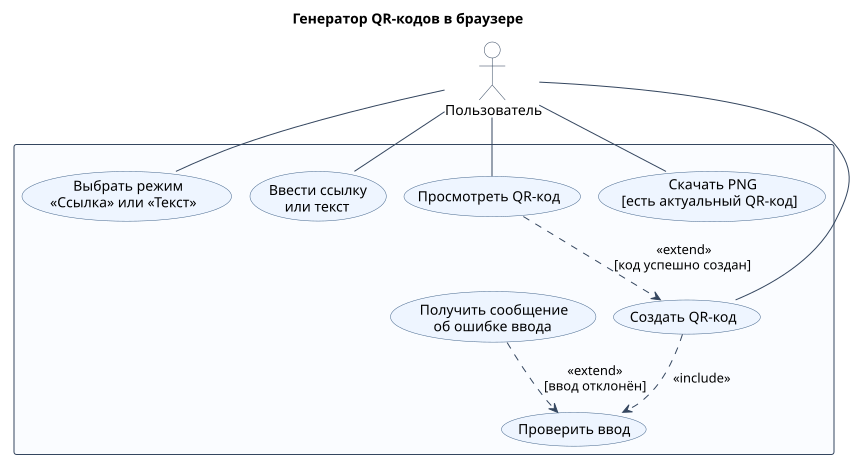

# Лабораторная работа № 5. Моделирование поведения

Вариант 69 — «Генератор QR-кодов для ссылок и текста». Модель описывает [текущий браузерный прототип](../../README.md), который проверяет ввод, рисует QR-код и сохраняет PNG. Единственный внешний актор — пользователь. Интерфейс, код проверки, библиотека QR и Canvas взаимодействуют в браузере. Учебная SQLite-модель из лабораторной № 4 в этих сценариях не участвует.

## Диаграмма вариантов использования



[PNG](../use_case/use_case_diagram.png) · [Исходник PlantUML](../use_case/use_case_diagram.puml)

Пользователь выбирает режим, вводит данные, создаёт и просматривает QR-код и при необходимости скачивает PNG. Пунктирная стрелка `«include»` от генерации к проверке означает обязательный шаг. Связь `«extend»` показывает условное поведение: при отклонённом вводе появляется сообщение об ошибке, а после успешной генерации открывается предпросмотр. Скачивание — отдельное действие, доступное при наличии актуального результата.

## Диаграммы последовательности

| Сценарий | Диаграмма | Требования |
| --- | --- | --- |
| SQ-01. Смена режима и редактирование | [PNG](sequence/select_mode_sequence.png) · [SVG](sequence/select_mode_sequence.svg) · [PlantUML](sequence/select_mode_sequence.puml) | FR-01, FR-03, FR-07 |
| SQ-02. Успешная генерация и просмотр | [PNG](sequence/generate_qr_sequence.png) · [SVG](sequence/generate_qr_sequence.svg) · [PlantUML](sequence/generate_qr_sequence.puml) | FR-02, FR-04–FR-06, REL-02 |
| SQ-03. Ошибка ввода или генерации | [PNG](sequence/handle_error_sequence.png) · [SVG](sequence/handle_error_sequence.svg) · [PlantUML](sequence/handle_error_sequence.puml) | FR-02, FR-04, FR-07, REL-01 |
| SQ-04. Скачивание PNG | [PNG](sequence/export_png_sequence.png) · [SVG](sequence/export_png_sequence.svg) · [PlantUML](sequence/export_png_sequence.puml) | FR-07–FR-09, REL-02 |

**SQ-01.** При открытом редакторе пользователь меняет режим или редактирует поле. Смена режима показывает подходящее поле. Оба события сбрасывают ошибку и прежний результат, скрывают QR-код и отключают скачивание. После этого пользователь может запустить генерацию заново.

**SQ-02.** Пользователь вводит, например, `https://example.org` и нажимает «Создать QR-код». Форма не перезагружает страницу. Проверка `validateInput()` подтверждает допустимость ссылки или текста длиной до 1000 байт UTF-8. Библиотека строит матрицу с коррекцией M. Canvas показывает чёрные модули на белом фоне с полем от четырёх модулей. После появления результата становится доступно скачивание.

**SQ-03.** Пустая строка, ссылка с пробелом или строка длиннее 1000 байт отклоняется до кодирования. Приложение показывает причину и возвращает фокус полю. Если допустимую строку не удалось закодировать или отрисовать, появляется сообщение о сбое генерации. В обоих случаях введённые данные остаются в форме, а предварительный просмотр и скачивание недоступны.

**SQ-04.** После успешной генерации пользователь нажимает «Скачать PNG». Canvas асинхронно готовит изображение. Перед скачиванием приложение сверяет номер поколения результата с сохранённым номером. Если пользователь успел изменить ввод или режим, прежний файл не скачивается. При успехе браузер сохраняет PNG 512 × 512 под именем `qr-link.png` или `qr-text.png`. При сбое подготовки PNG приложение показывает ошибку.

Реализация сценариев: [обработчики интерфейса и экспорта](../../script.js) и [проверка ввода](../../validation.js). Требования приведены в [ТЗ](../../wiki/Техническое-задание.md).

## Повторный экспорт

Диаграммы созданы в PlantUML 1.2025.4. Диаграмма вариантов использования использует встроенную раскладку Smetana. Оформление диаграмм последовательности вынесено в [общий файл](sequence/_style.iuml). Из корня репозитория, указав путь к JAR:

```sh
java -jar /path/to/plantuml.jar -failfast2 -charset UTF-8 -tpng docs/use_case/use_case_diagram.puml docs/behavior/sequence/*_sequence.puml
java -jar /path/to/plantuml.jar -failfast2 -charset UTF-8 -tsvg docs/use_case/use_case_diagram.puml docs/behavior/sequence/*_sequence.puml
```
